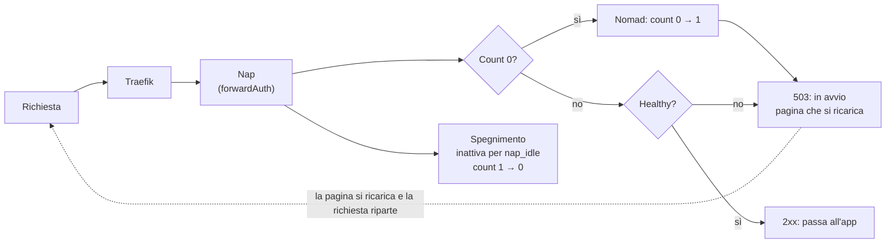

# Nap: scale-to-zero per Nomad

> Esportato il 15 ottobre 2026 dal [documento di design](https://claude.ai/code/artifact/50561bae-37c0-4e8e-9eb9-13768fae8274). Autore: Iacopo Melani.

## Idea

Nap spegne le app inattive di un cluster Nomad e le riaccende alla prima richiesta. Nasce da un problema reale: molte app di sviluppo sul cluster, che oggi vanno spente e riaccese a mano.

- Un prodotto indipendente da Nops, con la stessa filosofia e lo stesso flusso di sviluppo.
- Nessun codice condiviso con Nops: il processo (docs, CI, release) si copia una volta e poi evolve da solo.
- Stato: idea esplorata, spike fatto, fix su Nops mergiati. Non si è ancora deciso se partire.

## Alternative valutate

Nessuna copre il caso: più namespace, risveglio alla prima richiesta, configurazione nella jobspec.

| Strumento | Cosa fa su Nomad | Perché non basta |
| --- | --- | --- |
| [Sablier](https://github.com/sablierapp/sablier) | Nessun provider Nomad rilasciato. La [PR #1122](https://github.com/sablierapp/sablier/pull/1122) (draft, settembre 2026) lo aggiunge: count di un group 0 ↔ 1, meta `sablier.*`. Due tentativi precedenti chiusi (#355, #730). | Un'istanza gestisce un solo namespace. Non è detto che venga mergiata. |
| Nomad Autoscaler | Scala il count leggendo metriche a intervalli. | Spegne bene, ma non riaccende alla prima richiesta: la richiesta riceve un 503, nessuno la tiene in attesa, e la reazione aspetta scrape, intervallo e cooldown. La strategia `target-value` moltiplica il count attuale, quindi da 0 resta a 0. |

Con Sablier si potrebbe usare un'istanza per namespace, ciascuna con il suo middleware Traefik (`sablierUrl`). Per il multi-namespace c'era una bozza di commento da lasciare nella PR #1122, mai inviata.

## Design proposto

Nap è il target del `forwardAuth` di Traefik: ogni richiesta passa prima da Nap, che vede l'attività e sveglia l'app se dorme. Non serve nessun plugin.

- **Risveglio:** se il group è a count 0, Nap lo porta a 1 e risponde con una pagina "in avvio" che si ricarica da sola. Quando le allocazioni sono healthy risponde 2xx e Traefik fa passare la richiesta.
- **Spegnimento:** Nap porta il count a 0 dopo il periodo di inattività scritto nel meta del group (es. `nap_idle = "30m"`).
- **Requisiti sul job:** un blocco `scaling { min = 0 }` sul group, con `enabled` a true (il default), e il middleware Traefik nei tag del servizio. Il target è `namespace/job/group`.
- **Altri proxy:** lo stesso schema funziona con `forward_auth` di Caddy e `auth_request` di nginx.
- **Separato da Nops:** Nap sta nel percorso di ogni richiesta, Nops no. Hanno requisiti di disponibilità diversi, quindi binari e job diversi.

Flusso di una richiesta verso un'app gestita da Nap:



Finché l'app non è healthy, chi la apre vede la pagina d'attesa; lo spegnimento è un timer separato, sempre dentro Nap.

L'MVP:

- un binario Go, con stato in memoria e niente SQLite: al riavvio tutte le app risultano attive e i timer ripartono;
- più namespace fin dall'inizio;
- metriche per Prometheus e una pagina d'attesa minimale;
- Traefik in polling (`refreshInterval`), non in `watch`: vedi lo spike.

## Risultati dello spike

Il design base regge: con un group a count 0 Traefik tiene viva la route e chiama comunque il `forwardAuth`. Lo spike è stato fatto il 14 ottobre 2026 con Nomad 2.0.7, Traefik 3.7.14 (compilato dai sorgenti), un finto Nap in Python e due namespace (`dev`, `staging`).

| Verifica | Esito | Conseguenza per Nap |
| --- | --- | --- |
| App a count 0, prima richiesta | La prima riceve 503 "waking up", la successiva passa (0,5 s con un'app istantanea) | Il meccanismo funziona |
| Due namespace, un Traefik e un Nap | Funziona | Il multi-namespace non costa niente |
| `nomad job stop` invece di scale a 0 | La route sparisce: 404, Nap non riceve più richieste | Nap cambia solo il count, non ferma mai un job |
| Traefik in `watch`, job registrato già a count 0 | Nessuna route per 30 s, finché un altro servizio del namespace non genera un evento | Usare Traefik in polling. Possibile issue a Traefik |
| App che impiega 8 s a partire | 15 risposte 502 prima del 200: Nomad registra il servizio prima che l'health check passi | Nap fa passare le richieste solo con allocazioni healthy, più un margine per il polling di Traefik |
| Scale durante un deployment Nomad | Rifiutato con 400 "job scaling blocked due to active deployment" | Nap riprova dopo e nel dubbio lascia l'app sveglia |

Dal codice di Traefik (`pkg/provider/nomad/nomad.go`): la route vuota esiste solo se il group ha `scaling` con `enabled` a true e count 0. In `watch` Traefik ascolta solo il topic `Service` dell'event stream.

## Filosofia e invarianti (bozza)

Nap eredita i principi di Nops, ma per Nap la strada sicura è restare sveglia: un errore non spegne mai un'app.

| Nops | Nap |
| --- | --- |
| Grow with the need | Uguale |
| Fail loud: nel dubbio la strada sicura | Uguale; la strada sicura è lasciare l'app sveglia |
| Git decide il comportamento; meta invalidi → policy `none` + ERROR | La jobspec decide il comportamento; meta invalidi → il group non viene mai addormentato + ERROR |
| Non scrive mai meta nel job live | Scrive solo il count |

Bozza di invarianti:

1. **Solo i group che lo chiedono.** Nap tocca solo i group con il suo meta attivo e `scaling { min = 0 }`.
2. **Solo il count, tra 0 e 1.** Non ferma, non registra, non modifica altro. Se Nomad rifiuta lo scale, riprova e lo segnala, senza forzare. *Perché:* `job stop` cancella la route; un register entrerebbe in conflitto con chi gestisce la spec.
3. **Nel dubbio, sveglia.** Addormenta un group solo dopo averlo visto inattivo per tutto il periodo. Dopo un riavvio i timer ripartono.
4. **Pronta vuol dire healthy.** Fa passare le richieste solo con allocazioni healthy, non a servizio registrato.

Non vengono da Nops il plan, l'approvazione, il deployment unico e lo stato persistito: perdere lo stato in memoria lascia tutte le app sveglie, cioè nella situazione sicura.

Da Nops si copiano, una volta, la struttura della documentazione (philosophy, glossary, Vale, `TestDocsSpeakToPeople`), CONTRIBUTING e `development.md`, la CI, `release.sh` e goreleaser, e la forma del CLAUDE.md.

## Convivenza con Nops

Fino al 14 ottobre 2026 Nops e Nap si scontravano sotto policy `approval`. I fix sono in Nops e sono in `main`: [nops#195](https://github.com/music-gang/nops/pull/195) chiude [nops#192](https://github.com/music-gang/nops/issues/192) (uno scale letto come modifica esterna), [nops#194](https://github.com/music-gang/nops/pull/194) chiude [nops#193](https://github.com/music-gang/nops/issues/193) (un deployment in più alla nascita di un job con `scaling`).

Nops non integra Nap e viceversa: si coordinano solo attraverso lo stato di Nomad. Nops mantiene già il count live dei group con `scaling`, ma ogni scale sposta il `JobModifyIndex` (misurato: run → 11, scale a 0 → 21, scale a 1 → 27), e Nops lo leggeva come una modifica manuale.

| Caso | Prima dei fix | Dopo i fix |
| --- | --- | --- |
| Nops aggiorna un'app che dorme | Deploy healthy subito (tutti i group a 0) | Uguale |
| Nap scala durante un deploy di Nops | Nomad rifiuta lo scale (400) | Uguale: Nap riprova |
| Scale con un deployment in `pending_approval` | Deployment sostituito, l'approvazione ricomincia | Stesso deployment, indice aggiornato |
| Scale dopo un rifiuto | La spec rifiutata viene riproposta | Resta rifiutata |
| Scale tra rilevamento e register | `failed` con "conflict" | Ricontrollo al ciclo dopo, poi register |
| Nascita di un job con scaling | Un deployment in più | Nessun deployment in più |

Il fix confronta l'hash del diff completo del plan invece dell'indice: su Nomad 2.0.7, dopo uno scale cambia solo il campo `Updates` del group (quante allocazioni tocca il plan, es. 1 → 3), che l'hash esclude; una modifica manuale cambia invece i campi del diff. Lo ha mostrato il test end-to-end, non lo spike, che confrontava solo i campi. Un `nomad job run` a mano riaccende l'app, perché riporta il count della spec: Nap la riaddormenterà.

Resta un caso aperto, lasciato fuori di proposito: per un job senza deployment Nomad (batch, o con `max_parallel = 0`), uno scale che arriva mentre Nops aspetta che il job diventi healthy lo fa ancora fallire. Per i service job non succede, perché Nomad rifiuta gli scale durante un deployment.

## Decisioni e domande aperte

Decisi:

- Nome: **Nap**.
- Due prodotti indipendenti con la stessa filosofia; niente suite, niente libreria condivisa.
- Risveglio con il `forwardAuth` nativo di Traefik, verificato dallo spike.
- Prima si sistema Nops ([nops#192](https://github.com/music-gang/nops/issues/192)), poi si decide se partire con Nap. Fatto: nops#194 e nops#195 sono in `main`.

Da decidere:

- [ ] Partire o no con Nap.
- [ ] Cosa vede l'utente durante l'avvio: pagina "in avvio" che si ricarica (proposta) o richiesta tenuta in attesa, magari scelta per group con un meta.
- [ ] Aggiornamento di un'app che dorme: resta a 0 e parte con la versione nuova al risveglio (proposta), oppure va svegliata prima. Gli hook post-deploy di Nops girano con l'app spenta.
- [ ] Margine dopo "healthy" per il polling di Traefik: fisso o configurabile.
- [ ] Repo `music-gang/nap`: da creare a mano.
- [ ] Issue a Traefik sul `watch` che non vede i job registrati a count 0.

## Appendice: rifare lo spike

I file servono a ripetere lo spike su un cluster vero o in locale. Il finto Nap dichiara pronta l'app appena il servizio è registrato: è proprio il difetto che lo spike ha trovato, e il Nap vero deve aspettare le allocazioni healthy.

1. `nomad agent -dev -config=agent.hcl`, poi `nomad namespace apply dev`.
2. `nomad job run whoami-dev.hcl`.
3. `traefik --configFile=traefik.yml` e `python3 fakenap.py`.
4. `nomad job scale -namespace dev whoami web 0`, poi `curl -H 'Host: whoami.dev.localhost' http://127.0.0.1:8000/`.

In `traefik.yml` va tolto `watch: true` (vedi lo spike). Il `fingerprint.denylist` serviva solo nel container dello spike.

`agent.hcl`

```hcl
plugin "raw_exec" {
  config { enabled = true }
}

client {
  options = {
    "fingerprint.denylist" = "env_aws,env_gce,env_azure,env_digitalocean"
  }
}
```

`whoami-dev.hcl`

```hcl
job "whoami" {
  namespace = "dev"

  group "web" {
    count = 1

    scaling {
      min = 0
      max = 1
    }

    network {
      port "http" {}
    }

    service {
      name     = "whoami"
      provider = "nomad"
      port     = "http"
      tags = [
        "traefik.enable=true",
        "traefik.http.routers.whoami-dev.rule=Host(`whoami.dev.localhost`)",
        "traefik.http.routers.whoami-dev.middlewares=nap-dev-whoami",
        "traefik.http.middlewares.nap-dev-whoami.forwardauth.address=http://127.0.0.1:9000/wake/dev/whoami/web",
      ]

      check {
        type     = "http"
        path     = "/"
        interval = "2s"
        timeout  = "1s"
      }
    }

    task "server" {
      driver = "raw_exec"

      config {
        command = "python3"
        args    = ["-m", "http.server", "${NOMAD_PORT_http}", "--bind", "127.0.0.1"]
      }
    }
  }
}
```

`traefik.yml`

```yaml
entryPoints:
  web:
    address: ":8000"
  traefik:
    address: ":8081"
api:
  insecure: true
log:
  level: INFO
providers:
  nomad:
    namespaces: ["dev", "staging"]
    allowEmptyServices: true
    watch: true
    exposedByDefault: false
    endpoint:
      address: "http://127.0.0.1:4646"
```

`fakenap.py`

```python
# Minimal stand-in for Nap: forwardAuth target that wakes a group and reports readiness.
import json, sys, time, urllib.request
from http.server import BaseHTTPRequestHandler, ThreadingHTTPServer

NOMAD = "http://127.0.0.1:4646"

def nomad(method, path, body=None):
    req = urllib.request.Request(NOMAD + path, method=method,
                                 data=json.dumps(body).encode() if body else None)
    with urllib.request.urlopen(req) as r:
        return json.load(r)

class H(BaseHTTPRequestHandler):
    def do_GET(self):
        _, _, ns, job, group = self.path.split("?")[0].split("/")
        host = self.headers.get("X-Forwarded-Host")
        spec = nomad("GET", f"/v1/job/{job}?namespace={ns}")
        count = next(g["Count"] for g in spec["TaskGroups"] if g["Name"] == group)
        if count == 0:
            nomad("POST", f"/v1/job/{job}/scale?namespace={ns}",
                  {"Count": 1, "Target": {"Group": group}, "Message": "woken by request"})
            print(f"{time.strftime('%X')} WAKE {ns}/{job}/{group} host={host}", flush=True)
            return self.reply(503, "waking up")
        regs = nomad("GET", f"/v1/service/{job}?namespace={ns}")
        if not regs:
            print(f"{time.strftime('%X')} STARTING {ns}/{job}/{group}", flush=True)
            return self.reply(503, "starting")
        print(f"{time.strftime('%X')} PASS {ns}/{job}/{group} host={host}", flush=True)
        self.reply(200, "")

    def reply(self, code, text):
        self.send_response(code)
        self.send_header("Content-Type", "text/plain")
        self.end_headers()
        self.wfile.write(text.encode())

    def log_message(self, *a): pass

ThreadingHTTPServer(("127.0.0.1", 9000), H).serve_forever()
```
